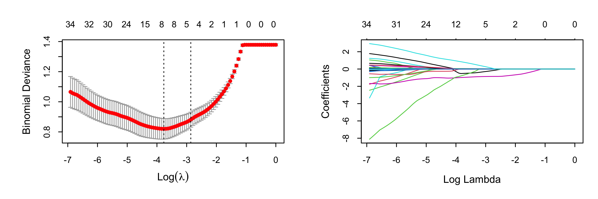
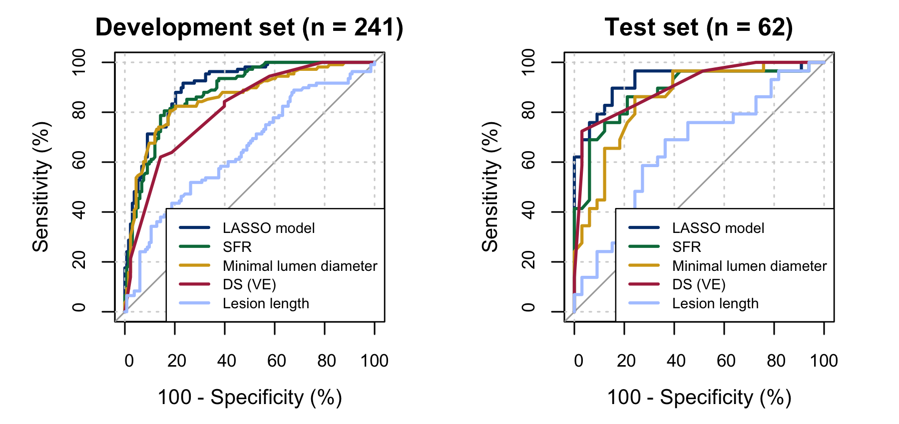
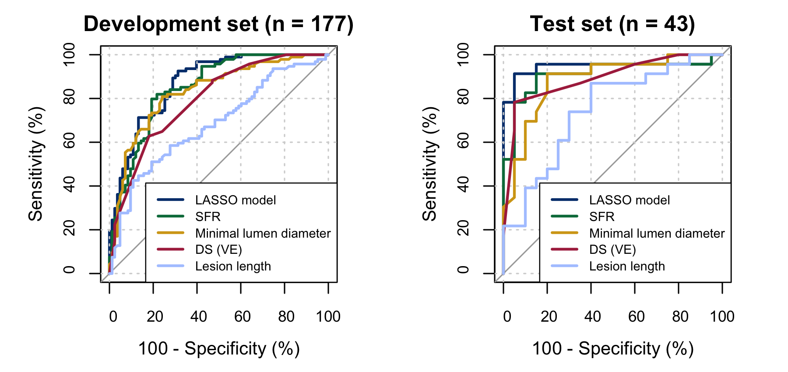

# QCA LASSO Analysis

## Overview
This project investigates whether quantitative coronary angiography (QCA)-derived and clinical features can be used to identify functionally significant coronary stenosis, using fractional flow reserve (FFR) as the reference standard. A LASSO logistic regression model was developed to select predictors and evaluate diagnostic performance at both the vessel and patient levels.

The repository contains a **reproducible R re-implementation** of an earlier analysis presented at SHEC 2024, and the corresponding [historical poster](Poster_SHEC2024_original.pdf) is preserved in this repository. 

> **Repository note:** During reconstruction of the analysis pipeline, several methodological aspects were refined, particularly patient-level data handling, development/test separation, cross-validation and evaluation. The repository represents a cleaned, reorganized, and methodologically strengthened version of the original workflow rather than a verbatim archival copy. The updated analysis produced broadly consistent findings, including overlap in LASSO-selected predictors and similar diagnostic performance.

## Dataset
The dataset contains **39 QCA-derived, clinical, and demographic features** from **303 coronary vessel observations from 220 patients**. Each observation represents an individual vessel and includes QCA-derived anatomical and hemodynamic measurements together with selected clinical variables.

At the vessel level, functionally significant stenosis is defined as FFR <= 0.80. For patient-level evaluation, a patient is considered positive if at least one of their evaluated vessels is positive.

## Analysis Pipeline

The [`src/r/`](src/r/) directory contains the complete R analysis pipeline.

| Script | Purpose |
| --- | --- |
| [`00_run_all.R`](src/r/00_run_all.R) | Runs the complete R analysis pipeline in sequence. |
| [`01_data_preparation.R`](src/r/01_data_preparation.R) | Cleans and structures the vessel-level data, constructs patient identifiers and outcomes, and creates the patient-level development/test split. |
| [`02_lasso_model.R`](src/r/02_lasso_model.R) | Performs patient-grouped cross-validation, compares `lambda.min` and `lambda.1se`, fits the final LASSO model, and generates vessel-level predictions. |
| [`03_model_evaluation.R`](src/r/03_model_evaluation.R) | Evaluates the final model at both vessel and patient levels, including ROC/AUC and classification metrics. |
| [`04_visualization.R`](src/r/04_visualization.R) | Compares the LASSO model with selected individual predictors and generates final ROC figures and summary tables. |

## Methods (updated)

The analysis uses LASSO logistic regression to identify informative predictors of functionally significant coronary stenosis from 39 QCA-derived and clinical candidate variables. FFR is used only to define the outcome and is excluded from the predictor set.

To reduce information leakage from multiple vessels belonging to the same patient, the development/test split is performed at the patient level, and all vessels from a given patient remain in the same subset. The same grouping principle is maintained during 10-fold cross-validation, so vessels from one patient are assigned to the same fold.

Both `lambda.min` and `lambda.1se` are examined during LASSO model selection. The final model uses `lambda.1se`, favoring a more parsimonious solution while remaining within one standard error of the minimum cross-validation error.

Model performance is evaluated at both vessel and patient levels. Patient-level predictions are obtained using the maximum predicted probability across vessels from the same patient. Classification thresholds are selected from the development set using Youden's index and then applied unchanged to the held-out test set.

## Results

The final `lambda.1se` LASSO model retained five predictors:
- diameter stenosis by visual estimation (DS_VE)
- minimal lumen diameter (MLD)
- lesion length (LL)
- stenotic flow reserve (SFR)
- family history of CAD

Several of these predictors were also identified in the original analysis, showing substantial consistency despite the revised data-handling and evaluation workflow.

### Held-out test performance

|   | n | AUC (95% CI) | Accuracy | Sensitivity | Specificity | PPV | NPV |
| --- | ---: | ---: | ---: | ---: | ---: | ---: | ---: |
| Vessel-level | 62 | 0.928 (0.857–0.999) | 0.823 | 0.897 | 0.758 | 0.765 | 0.893 |
| Patient-level | 43 | 0.946 (0.863–1.000) | 0.884 | 0.913 | 0.850 | 0.875 | 0.895 |

Patient-level performance is based on aggregation of vessel-level predictions rather than a separately fitted patient-level model. For further details, please refer to [`outputs/r/tables/`](outputs/r/tables/).

### LASSO cross-validation and coefficient paths

### Vessel-level ROC comparison

### Patient-level ROC comparison

## Limitations
- The dataset is relatively small, and the held-out test set is derived from the same source cohort rather than an independent external validation cohort.
- Multiple vessels may belong to one patient. Patient-level results are derived by aggregating vessel-level predictions and do not represent a separately trained patient-level model.
